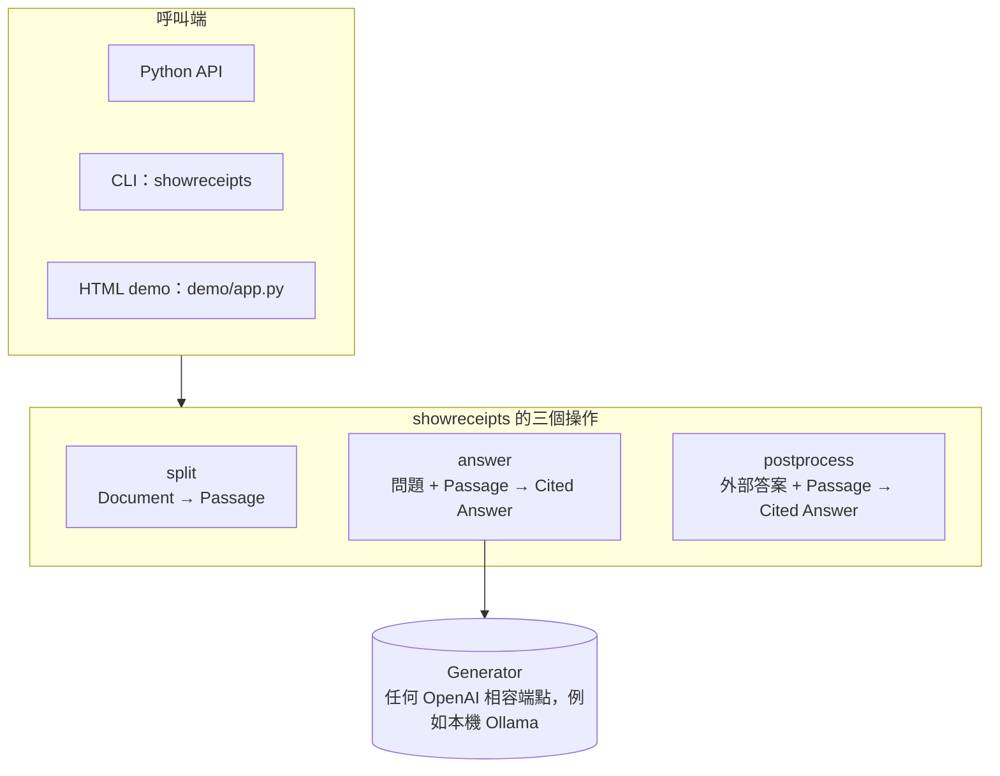
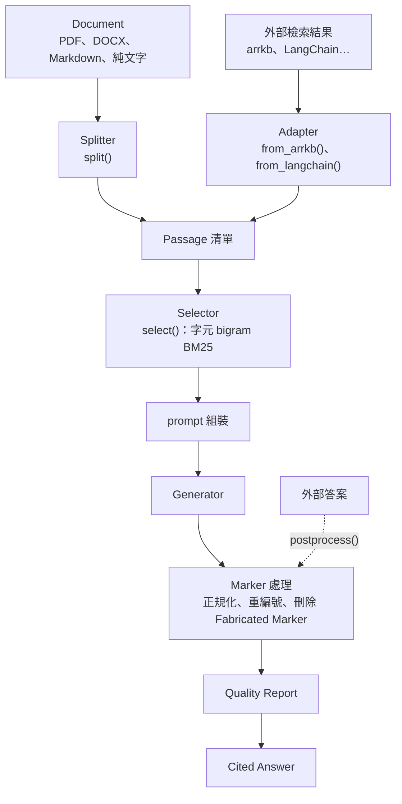

# showreceipts

不綁定任何 RAG 框架的引用層，一次處理一輪問答。段落可以來自任何檢索系統，也可以直接從上傳的文件切出來。輸出的答案帶 inline `[n]` 引用，並附一份不呼叫模型的 Quality Report。

- 小模型常寫的 `[1, 2]`、`[1-3]`、`[1–3]`、`[1～3]`、`[1、3]` 都會改寫成逐一的 `[1][2]`，再依答案中首次出現的順序從 1 重新連號。
- 對不到任何段落、由模型編造的編號（Fabricated Marker）會從答案中刪掉，並另外列出。
- fenced code、inline code、網址裡的方括號數字不會被處理。
- Quality Report 標出三種可疑處：低支持度的句子、含數字卻沒標來源的句子，以及所有來源裡都找不到的數字與日期。它只回報，不會攔下答案（見〈[Quality Report 只是字面訊號](#quality-report-只是字面訊號)〉）。

> 原名 Tag RAG。Tier 2 的本地 RAG demo（Streamlit + Chroma + LangChain）以 git tag `tier2-final` 保存。v1 依 [issue #9](https://github.com/xian-ai-1057/showreceipts/issues/9) 重寫。

## 架構

對外只有三個操作。Python API、CLI 和 demo 的 HTTP 端點一一對應，輸入輸出用同一套 JSON，也就是 `showreceipts.models` 的資料模型。



套件內部流程如下。`postprocess` 不呼叫模型，直接從 Marker 處理這一步進入。



- `answer` 不會自己選段。建議的順序是 split（或 Adapter）→ select → answer，寫在呼叫端程式裡；CLI 與 demo 就是這樣串的。
- Passage 依給定的順序編號，也就是上游 rerank 的順序，從不依 `score` 重排。重複的 Passage ID 只留第一個。
- Selector 和 Generator 都是可以注入的函式。預設的 Selector 不需要向量庫；預設的 Generator 只用 stdlib 呼叫 OpenAI 相容端點。
- 核心套件只依賴 Python 3.11+ 與 Pydantic v2，不 import 任何 RAG 框架或 demo 程式，由 `tests/test_isolation.py` 檢查。

術語（Passage、Locator、Citation Marker、Fabricated Marker…）見 [GLOSSARY.md](GLOSSARY.md)，架構決策見 [docs/adr/](docs/adr/)。

## 安裝

需要 Python 3.11+。建議用 [uv](https://docs.astral.sh/uv/)：

```bash
git clone https://github.com/xian-ai-1057/showreceipts.git
cd showreceipts
uv sync --all-extras    # 核心 + 全部 extras + 開發工具（pytest、langchain-core…）
```

核心只依賴 Pydantic。其他依賴用 extras 按需安裝：

| extra | 內容 | 用途 |
|---|---|---|
| `pdf` | `pypdf[crypto]` | `split` 讀 PDF（含 AES 加密、只限制列印與複製的 PDF） |
| `docx` | `python-docx` | `split` 讀 DOCX |
| `demo` | `fastapi`、`uvicorn` | demo 後端 |

```bash
uv sync --extra pdf --extra demo              # 只裝需要的 extra
pip install -e ".[pdf,docx,demo]"             # 不用 uv 時
```

缺 extra 時，`split` 會拋出 `ImportError`，訊息裡附安裝指令，例如 `uv sync --extra pdf, or pip install 'showreceipts[pdf]'`。Markdown 與純文字不需要任何 extra。套件沒有發布到 PyPI。

### 設定模型端點

預設 Generator（`OpenAICompatGenerator`）的設定由 CLI、demo 後端與 LangChain 範例讀環境變數；核心套件本身不讀環境變數，也不讀 `.env`。

| 環境變數 | 預設值 | CLI 參數 |
|---|---|---|
| `SHOWRECEIPTS_BASE_URL` | `http://localhost:11434/v1`（本機 Ollama） | `--base-url` |
| `SHOWRECEIPTS_MODEL` | `qwen3.5:4b-mlx` | `--model` |
| `SHOWRECEIPTS_API_KEY` | `ollama` | `--api-key` |

```bash
cp .env.example .env              # 填值；.env 已被 gitignore
uv run --env-file .env showreceipts answer -q "Richart 卡正卡年費多少？" data/richart.md
```

呼叫採 temperature 0、不串流（non-streaming），逾時 600 秒。連線失敗、408、409、429 或 ≥500 時最多重試 2 次（間隔 0.5 秒、1 秒），失敗一律包成 `GeneratorError`。

### 連本機模型：設定 NO_PROXY

如果環境設了 `HTTP_PROXY`／`HTTPS_PROXY`，Python 的 urllib 連 `localhost` 時也會走 proxy，請求到不了本機的 Ollama。連本機模型時，請把 localhost 排除在 proxy 之外：

```bash
export NO_PROXY=localhost,127.0.0.1    # 或寫進 .env
```

## 三條使用路徑

先啟動 demo；只需要 Ollama 這一個外部服務，不需要向量庫或 embedding 模型：

```bash
uv run --env-file .env --all-extras uvicorn demo.app:create_app --factory
# 打開 http://127.0.0.1:8000/ ；API 文件頁在 http://127.0.0.1:8000/docs
```

畫面上可以：

- 點答案中的 `[n]`，在側欄看該段原文、Source 與 Locator。
- 看 Quality Report 的標示：沒標來源的數字句加底色，低支持度的句子加虛線，來源裡找不到的數字標紅。
- 展開「原始答案 vs. 處理後答案」，看被刪掉的 Fabricated Marker。

問答只保留在頁面上，重新整理就清空。

### 1. 上傳文件直接問

這條路徑模擬「使用者在對話中上傳一份文件就問」，不需要任何檢索系統。流程是 split → select → answer。

- **Demo**：選「上傳 Document」，挑一個 `.md`、`.txt`、`.pdf` 或 `.docx` 檔，或按「改用範例 richart.md」。「預覽切段」會列出每段的 Locator 與 Passage ID。
- **CLI**：`showreceipts answer -q "問題" 文件路徑`，見〈[CLI](#cli)〉。
- **Python**：

```python
from showreceipts import OpenAICompatGenerator, answer, select, split

question = "Richart 卡正卡年費多少？一般消費的回饋是多少？"
passages = split("data/richart.md")            # 也可傳 (位元組, 檔名)，例如 split((data, "合約.pdf"))
selected = select(question, passages)          # 總字數超過 12,000 才挑段，回傳時保持原順序
generator = OpenAICompatGenerator(base_url="http://localhost:11434/v1", model="qwen3.5:4b-mlx", api_key="ollama")

cited = answer(question, selected, generator)
print(cited.answer)
for c in cited.citations:
    print(c.n, c.passage.source, c.passage.locator)
print(cited.model_dump_json(indent=2))         # 整份 Cited Answer 都能直接序列化
```

Splitter 會盡量在標題或段落邊界切段，每段約 500 字，可用 `target_chars` 調整。Locator 依格式而定：

| 格式 | Locator |
|---|---|
| PDF | 「第 n 頁」，從 1 起算；段落不跨頁 |
| DOCX、Markdown | 標題路徑，例如 `三、切換刷方案 > Pay 著刷` |
| 純文字 | 空字串 |

Passage ID 是 `sha256(文件位元組)` 的前 12 碼加上 `:段落序號`，同一份文件重切會得到相同的 ID。Source 預設是檔名，可用 `source=` 覆寫。XLSX、HTML 與掃描型 PDF 不支援，遇到時拋 `ValueError`。

### 2. 貼上外部檢索結果（Passage JSON）

這條路徑模擬「Passage 由任何外部檢索系統提供」。流程是 select → answer。

- **Demo**：選「貼上 Passage JSON」。輸入框已預填 `data/richart_passages.json`，那是舊 arrkb 樣本轉成的 6 段 Richart 資料。可以試問：「切換 Pay 著刷最高回饋多少？在超商用 LINE Pay 有回饋嗎？」、「繳保費可以拿到多少回饋？切換假日刷呢？」
- **CLI**：`showreceipts answer -q "問題" --passages passages.json`。
- **Python**：自己組 `Passage`，或用 Adapter 轉換外部系統的結果：

```python
from showreceipts import Passage
from showreceipts.adapters import from_arrkb, from_langchain

passages = [Passage(id="doc-7#3", text="正卡每卡每年 NT$4,500。", source="權益手冊.pdf", locator="第 3 頁")]
passages = from_arrkb(arrkb_response)          # {"data": [...]}、多筆 list 或單筆都可以
passages = from_langchain(docs)                # 任何有 page_content 與 metadata 的物件
```

Passage JSON 是一個清單，每段的欄位如下：

| 欄位 | 說明 |
|---|---|
| `id` | 必填，非空字串，格式由上游決定 |
| `text` | 必填，內文 |
| `source` | 必填，只用來顯示 |
| `locator` | 選填，預設空字串 |
| `score` | 選填，只用來顯示 |
| `metadata` | 選填，原樣保留 |

不允許其他欄位。`from_langchain` 可用 `id_key`、`source_key` 指定讀哪個 metadata 欄位（`metadata[id_key]` 優先，沒有時才用文件的 `.id`），用 `locator_fn` 自訂 Locator；預設 Locator 取 `page_label`，沒有時取 `page`，只給 0-based `page` 的 loader 請傳 `locator_fn`。文件沒有 id 時，會以 `source + text` 的雜湊產生穩定 ID，並記一則 warning。

### 3. 只做後處理：LangChain 範例

答案由別處產生，例如 LangChain、你自己的 harness 模型或 agent，showreceipts 只做後處理。`examples/langchain_postprocess.py` 用 LangChain 的鏈產生從 0 開始編號的答案（`[0]`、`[1]`…），再經 `postprocess(..., input_marker_base=0)` 改成從 1 連號，並刪掉不存在的編號。showreceipts 本身不需要安裝 LangChain，範例只用到開發依賴 `langchain-core`。

```bash
uv run --env-file .env python examples/langchain_postprocess.py "切換 Pay 著刷最高回饋多少？"
```

在 Python 裡直接呼叫：

```python
import json
from showreceipts import Passage, ShowReceiptsConfig, postprocess

passages = [Passage.model_validate(p) for p in json.load(open("data/richart_passages.json", encoding="utf-8"))]
cited = postprocess("年費 NT$4,500 [1]。LINE Pay 在超商沒有回饋 [2, 9]。", passages)
cited.answer               # '年費 NT$4,500 [1]。LINE Pay 在超商沒有回饋 [2]。'
cited.fabricated_markers   # ['[2, 9]']：只有 6 段，9 對不到任何 Passage

postprocess("見 [0]。", passages, config=ShowReceiptsConfig(input_marker_base=0)).answer   # '見 [1]。'
```

`postprocess` 用 Passage 在原始清單中的位置（含重複的項目）對應答案裡的編號。Passage ID 不重複且 `input_marker_base=1` 時，同一段原始答案走 `answer` 或 `postprocess`，得到的 Cited Answer 完全相同。

## CLI

console script 是 `showreceipts`，結果以 JSON 輸出到 stdout。失敗時錯誤訊息寫到 stderr，exit code 為 1；`GeneratorError` 與輸入錯誤都算失敗。

```bash
# split：Document → Passage JSON
uv run showreceipts split data/richart.md --target-chars 500 --source "Richart 權益"

# answer：問題 + Document（先 split）或 Passage JSON → select → Generator → Cited Answer JSON
uv run --env-file .env showreceipts answer -q "Richart 卡正卡年費多少？" data/richart.md
uv run --env-file .env showreceipts answer -q "繳保費可以拿到多少回饋？" --passages data/richart_passages.json --budget 8000

# postprocess：答案文字（--answer-file 或 stdin）+ Passage JSON → Cited Answer JSON
echo '年費 NT$4,500 [1]。LINE Pay 在超商沒有回饋 [2, 9]。' | uv run showreceipts postprocess --passages data/richart_passages.json
uv run showreceipts postprocess --passages data/richart_passages.json --answer-file answer.txt --input-marker-base 0
```

| 子指令 | 主要參數 |
|---|---|
| `split` | `document`、`--target-chars`（預設 500）、`--source` |
| `answer` | `-q/--question`、`document` 與 `--passages` 擇一、`--budget`（預設 12000）、`--base-url`、`--model`、`--api-key` |
| `postprocess` | `--passages`、`--answer-file`（省略時讀 stdin）、`--input-marker-base`（0 或 1，預設 1） |

完整說明見 `showreceipts <子指令> --help`。

## Demo 的 HTTP 端點

三個端點都收發 JSON，與 CLI 的三個操作一一對應。Document 以 base64 放在 JSON 裡傳。

| 端點 | 請求 | 回應 |
|---|---|---|
| `POST /split` | `{document: {filename, data_base64}, target_chars?}` | Passage 清單 |
| `POST /answer` | `{question, passages? 或 document?, budget?, config?}`，`passages` 與 `document` 擇一 | Cited Answer |
| `POST /postprocess` | `{answer_text, passages, config?}` | Cited Answer |

錯誤時回應本文都是 `{"detail": ...}`：`GeneratorError` 回 502，輸入錯誤回 422（包括驗證失敗、不支援的格式、缺 extra）。`GET /` 是 demo 頁面，`/docs` 是 FastAPI 自動產生的 API 文件頁，可以直接試打端點。測試或嵌入時，可用 `create_app(generator=你的函式)` 建立 app。

## 自訂

`answer` 與 `postprocess` 都接受 `config=ShowReceiptsConfig(...)`。設定物件是 frozen 的，HTTP 端點收的 `config` 也是同一個 JSON。

| 欄位 | 預設 | 說明 |
|---|---|---|
| `system_prompt` | 內建 6 條作答規則 | 給字串時整段覆寫；覆寫後 `language` 不生效 |
| `user_prompt_template` | 內建 | 可用 `{context_blocks}`、`{question}` |
| `passage_block_template` | `[n] 來源: {source}（{locator}）` 加內文；Locator 為空時省略括號 | 可用 `{n}`、`{source}`、`{locator}`、`{text}` |
| `language` | `繁體中文` | 只代入預設 system prompt 的作答語言那條規則 |
| `no_answer_reply` | `依現有資料無法回答` | 沒有任何 Passage 時不呼叫模型，直接回這句 |
| `input_marker_base` | `1` | 只影響 `postprocess`：答案編號從 0 或 1 開始 |
| `enable_quality_report` | `True` | 關閉時 `quality_report` 為 `null` |

模板少了 placeholder 時只記 warning，不會拋例外。

- **自訂 Generator**：任何 `(system_prompt, user_prompt) -> str` 的函式都可以。它拋的例外會原樣往上拋，不會重試；回傳值不是字串時拋 `TypeError`。
- **自訂 Selector**：任何 `(question, passages, budget) -> list[Passage]` 的函式都可以，例如 embedding 版本。

## Cited Answer

| 欄位 | 內容 |
|---|---|
| `answer` | 處理後的答案：`[n]` 從 1 連號，Fabricated Marker 已刪除；可能是空字串 |
| `raw_answer` | Generator 的原始輸出，或傳給 `postprocess` 的原文 |
| `citations` | `[{n, passage}]`，`n` 與答案中的 `[n]` 一致 |
| `passages` | 去重後、依給定順序的全部 Passage；空清單代表走了 No-Answer Reply |
| `fabricated_markers` | 含 Fabricated Marker 的原始群組字串，例如 `"[2, 99]"`、`"[3-1]"` |
| `quality_report` | 見下節；關閉或走 No-Answer Reply 時為 `null` |

## Quality Report 只是字面訊號

Quality Report 是確定性的字面比對，不呼叫模型。它從不改動或攔下答案，要不要顯示、警告或拒答，由呼叫端決定。它檢查三件事：

- **`sentence_supports`**：每一句和它引用的 Passage 之間，字元 3-gram 的重疊率。達 0.15 算 supported；`quality_score` 是 supported 句數除以總句數。
- **`unsupported_entities`**：答案中的數字（含萬、億、% 等單位）與日期（含民國年），在所有 Passage 內文裡都找不到的那些。
- **`uncited_sentences`**：含十進位數字卻沒有任何 `[n]` 的句子。行首的清單序號（`2.`）不算數字；中文數字、人名和組織名不判斷。

**請把分數當成「這句話和來源字面上有多像」的訊號，而不是正確性分數：**

- 照抄來源的句子分數很高，即使抄錯了段落、或斷章取義也一樣。
- 換句話說的正確答案分數會偏低。
- 表格列、帶年份的標題這類句子也可能被標出來。

建構 Quality Report 時若發生例外，只記一則 warning，`quality_report` 設為 `null`，答案照常回傳。

## 範圍

v1 只處理單輪問答。追問要由呼叫端自己改寫成完整問句再送入，持久化的對話歷史也由呼叫端自己保存。

不在範圍內：串流輸出、LLM-as-judge、NER 套件、依 score 重排、依 Quality Report 攔截答案、XLSX／HTML／掃描型 PDF、向量庫或 embedding（呼叫端可以注入自己的 Selector）、MCP server、發布到 PyPI。完整清單見 issue #9 的 Out of Scope。

## 開發

```bash
uv sync --all-extras
uv run --all-extras pytest -q     # 全部離線，模型一律用假 Generator
```

需要真模型的測試標 `requires_ollama`，預設不執行，用 `-m requires_ollama` 才會跑。demo 前端沒有自動化測試，以手動 UAT 驗收，結果記在 [docs/uat-v1.md](docs/uat-v1.md)。給 Claude Code 的專案規則見 [CLAUDE.md](CLAUDE.md)。

## 文件

- [GLOSSARY.md](GLOSSARY.md)：術語
- [docs/adr/](docs/adr/)：架構決策（0001 引用層定位、0002 重寫、0003 文件切段）
- [docs/uat-v1.md](docs/uat-v1.md)：v1 UAT 紀錄
- [docs/research/related-projects.md](docs/research/related-projects.md)：相關專案調查
- [specs/archive/](specs/archive/)：Tier 2 時期的 Spec 100–106，只供參考
